# Record your drives with Cloudflare

rivian-mcp on your computer answers questions about your Rivian as it is now, such as its battery level. It cannot remember where you drove, because it only runs while you use it.

For that, you can run a small copy of it in your own Cloudflare account. It stays connected to your Rivian, records every drive and charge, and lets Claude or ChatGPT answer questions like "Show my last drive" or "How far did I drive this month?"

This is optional. The local version keeps working without it.

This is unofficial. It is not affiliated with or endorsed by Rivian. It only reads data from Rivian. The one thing it sends is your sign-in.

## What you need

- A free [Cloudflare](https://dash.cloudflare.com/sign-up) account. Step 1 shows how to create it.
- A free [GitHub](https://github.com/signup) account. Cloudflare keeps your copy of the project there.
- Your Rivian email and password, and the phone or email that gets Rivian's one-time code.
- A [Claude](https://claude.ai) account, ChatGPT or Codex. See [Connect Claude](#connect-claude), [Connect ChatGPT](#connect-chatgpt) and [Connect Codex](#connect-codex).

Plan on 15 minutes.

## Cost

Start with the free Cloudflare plan. Its limits for the part that stays connected to your Rivian (Durable Objects) are 100,000 requests and 13,000 GB-seconds per day ([Cloudflare pricing](https://developers.cloudflare.com/durable-objects/platform/pricing/)). I have not measured how much of that this uses. If recording stops partway through a day, you hit a limit. Workers Paid starts at $5 per month.

## Step 1: Deploy

1. Select this button:

   [](https://deploy.workers.cloudflare.com/?url=https://github.com/zentered-studios/rivian-mcp)

2. Sign in to Cloudflare. No account yet? Select **Sign up**, enter your email and a password, and open the link in the verification email. Skip the offers to add a website.
3. Connect your GitHub account when asked.
4. On **Select a repository**, the project's address is under **Clone a public repository via Git URL**. If the field is empty, paste `https://github.com/zentered-studios/rivian-mcp`. Select **Next**.

   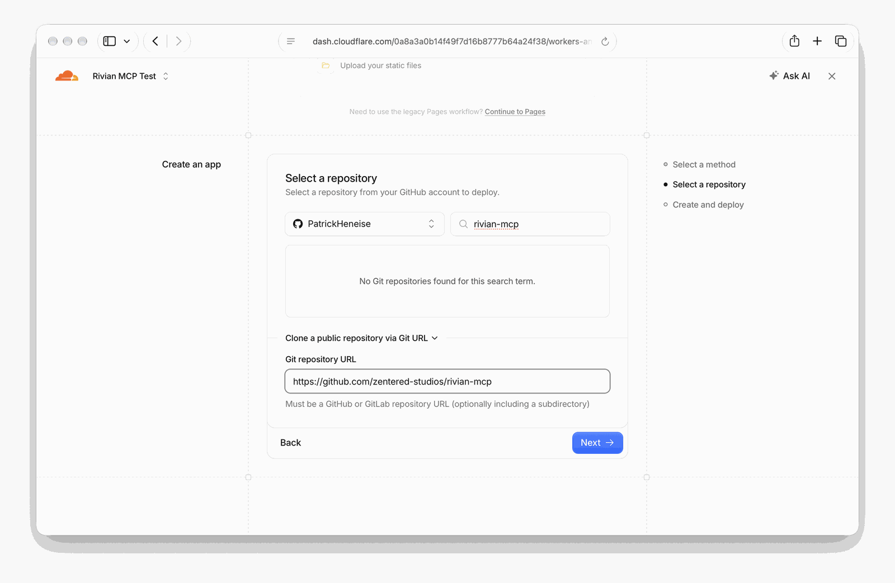

5. On **Create and deploy**, keep **Create private Git repository** checked, keep the project name `rivian-mcp` and leave the KV namespace on **Create new**. Select **Deploy**.

   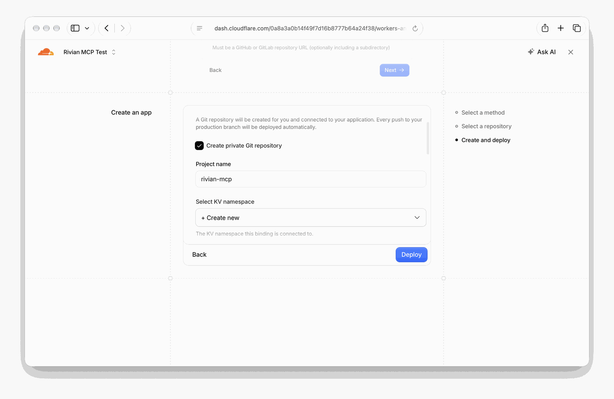

6. Turn off preview builds: open **Workers & Pages**, then **rivian-mcp**, then **Settings**, then **Build**. Under **Branch control**, clear **Enable Preview Builds**. Your copy has one recorder, so a preview of another branch has nothing to do.

Cloudflare copies the project to your GitHub, creates the storage it needs, sets up the database and starts it. This takes a few minutes. When it is done, it shows your address:

```text
https://rivian-mcp.<your-name>.workers.dev
```

You can find it again in the Cloudflare dashboard: **Workers & Pages**, then **rivian-mcp**, then **Domains**.

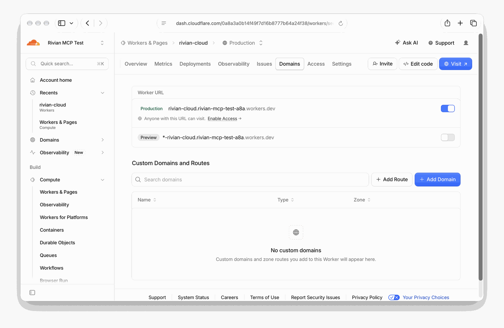

If the build fails, open the build log under **Deployments**.

## Step 2: Find your connector address

Add `/mcp` to the end of your address:

```text
https://rivian-mcp.<your-name>.workers.dev/mcp
```

To check it, open it in a browser. A blank page or `Unauthorized` means it runs. A Cloudflare error page means the deploy failed. Open **Workers & Pages**, then **rivian-mcp**, then **Deployments** to see why.

## Sign in

Claude, ChatGPT and Codex all open the same two pages from your copy when they connect. The page names the app that asks for access.

1. Enter your Rivian email and password and select **Sign in and allow**. The first account that signs in becomes the owner of your copy, so connect right after you deploy.

   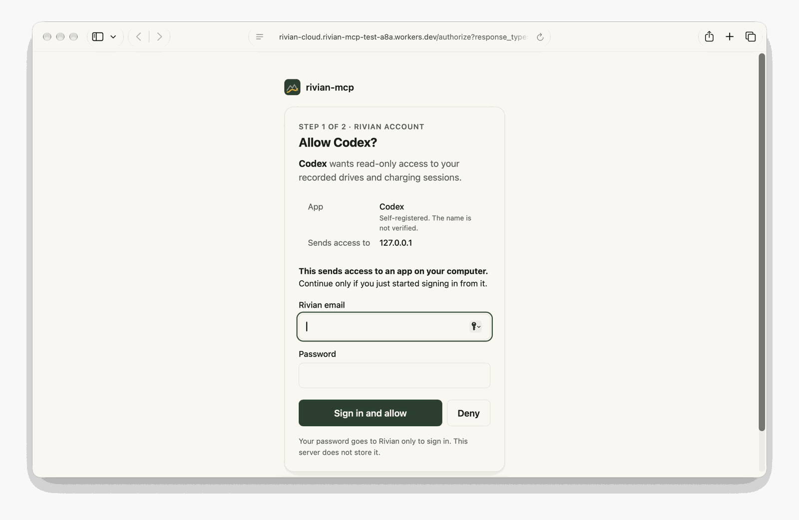

2. Rivian sends a one-time code to your phone or email. Enter it and select **Verify and connect**.

   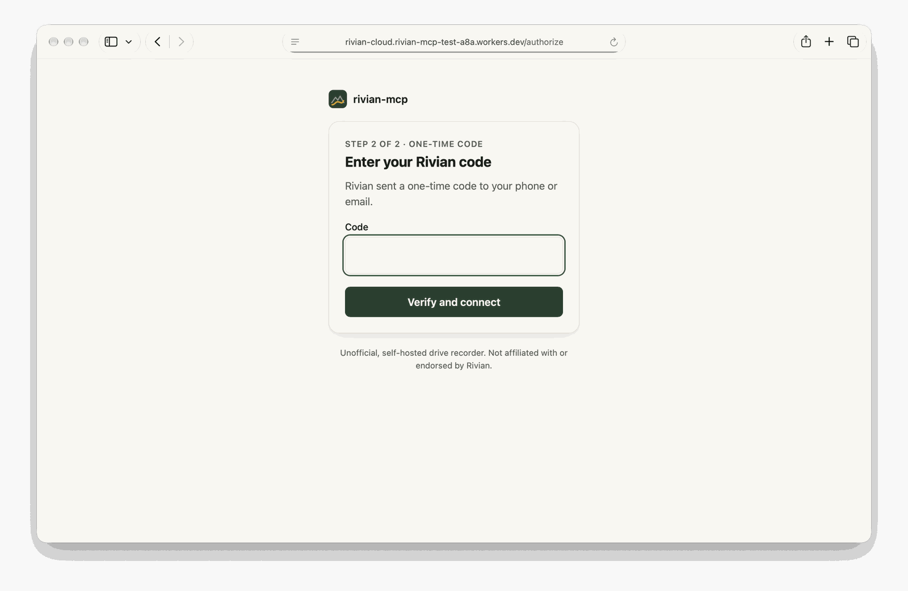

Your password goes to Rivian only to sign in. Your copy does not store it.

## Connect Claude

Works on claude.ai and in the Claude desktop and mobile apps. Custom connectors are available on Free (one connector), Pro, Max, Team and Enterprise ([Anthropic's guide](https://support.claude.com/en/articles/11175166-get-started-with-custom-connectors-using-remote-MCP)).

1. In Claude, open **Settings**, then **Connectors**.
2. Select **Add custom connector**.
3. Name it `Rivian` and paste your connector address. Leave the advanced settings empty.
4. Select **Add**, then **Connect**.
5. Your sign-in page opens. [Sign in](#sign-in) with your Rivian email, password and one-time code.
6. You are back in Claude, and recording has started.

Try it: in a new chat, turn on the Rivian connector in the **+** menu and ask "Is the recorder running?" Drives show up after your next trip. Ask "Show me the last drive on the map" for the route and the drive's numbers.

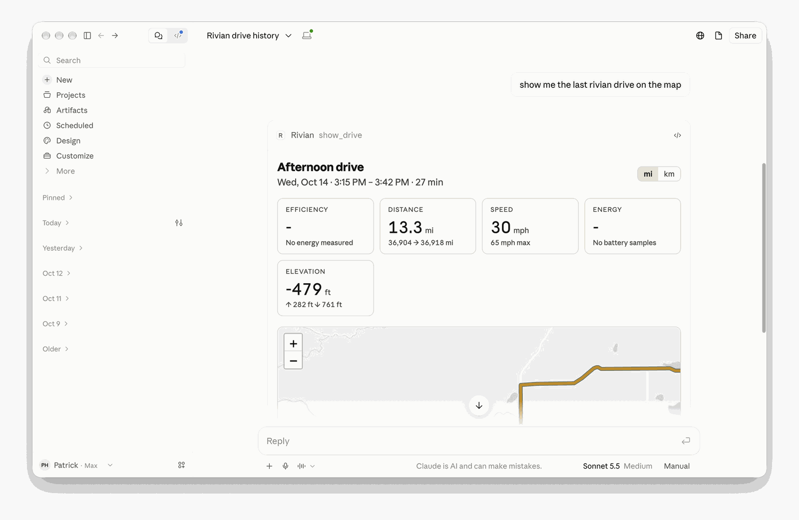

On Team and Enterprise plans, an owner adds the connector under **Organization settings**, then **Connectors**. Each member then selects **Connect**.

## Connect ChatGPT

Tested in the ChatGPT desktop app. Which plans include custom MCP servers is in [OpenAI's help article](https://help.openai.com/en/articles/12584461-developer-mode-apps-and-full-mcp-connectors-in-chatgpt-beta).

1. In ChatGPT, open **Customize**, then **Plugins**.
2. Select **Add**, then **Add custom MCP server**.
3. Name it `Rivian`. Under **Connection**, keep **Server URL** and paste your connector address.
4. Leave **Authentication** on **OAuth or no authentication**. Leave the advanced OAuth settings alone.
5. Check **I understand and want to continue**, then select **Create as a plugin**.

   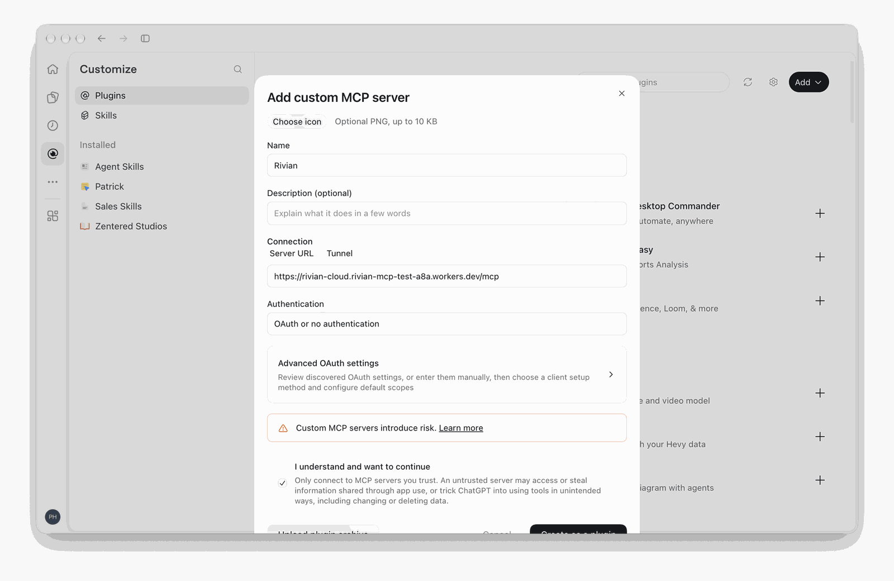

6. Your sign-in page opens. [Sign in](#sign-in) with your Rivian email, password and one-time code.

Try it: in a new chat, ask "Rivian status".

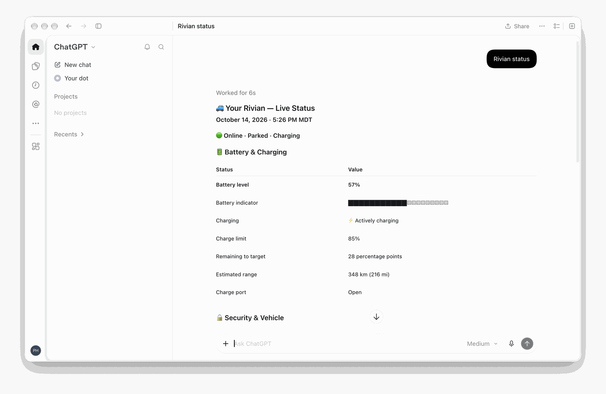

## Connect Codex

Tested in the Codex desktop app.

1. In Codex, open **Settings**, then **Plugins** under **Integrations**.
2. Select **Add**, then **Add MCP server**.

   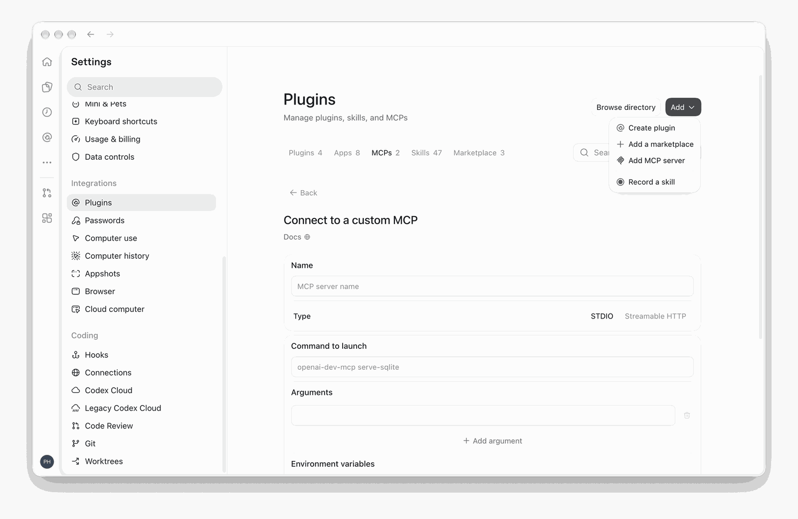

3. Name it `Rivian`. Set **Type** to **Streamable HTTP** and paste your connector address. Leave the bearer token and the headers empty.
4. Select **Save**.

   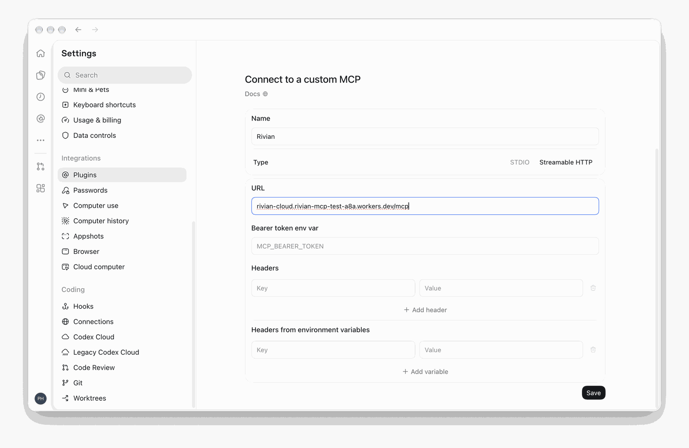

5. In a new chat, ask "Connect to Rivian". Your browser opens the sign-in page. [Sign in](#sign-in) with your Rivian email, password and one-time code. The browser then shows "Authentication complete. You may close this window."

   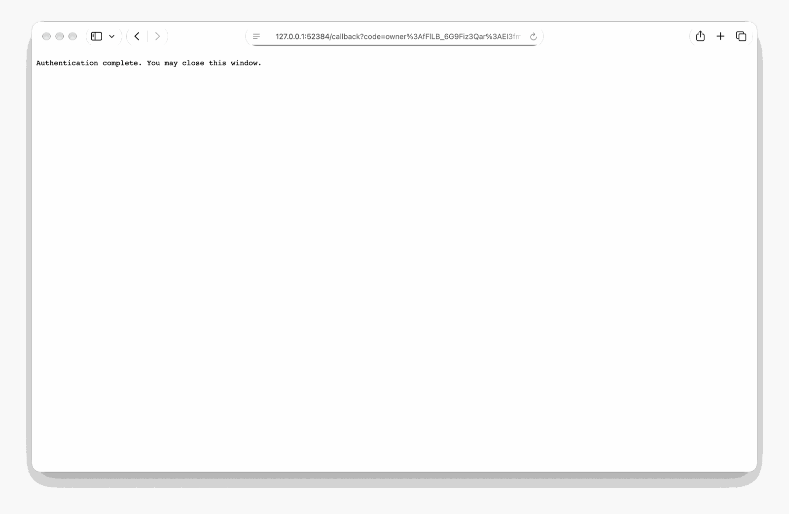

## What you can ask

- "Is the recorder running?"
- "List my drives this week."
- "Show my last drive." Claude shows a map, elevation and speed.
- "Show my stats for the last 30 days."
- "Show my charging sessions."
- Everything the local version answers: "What's my battery level?", "Is there a software update?"

## When Rivian signs you out

Rivian ends sign-ins after a while. When that happens, Claude says "Not signed in to Rivian". Open **Settings**, then **Connectors**, select the Rivian connector, and connect it again. You sign in once more, and recording continues.

## Update

Your copy lives in your GitHub account. It is not a fork, so GitHub shows no **Sync fork** for it. To get a newer version, pull the changes from <https://github.com/zentered-studios/rivian-mcp> into your copy:

```sh
git clone https://github.com/<your-github-name>/<your-copy>.git
cd <your-copy>
git pull https://github.com/zentered-studios/rivian-mcp.git main
git push
```

Cloudflare deploys every change to your copy by itself.

## Your data

- Everything stays in your Cloudflare account: drives in a D1 database, sign-in data in a KV store. To look at the rows, open **Storage & Databases**, then **D1**, then **rivian-mcp**, then **Studio**.

  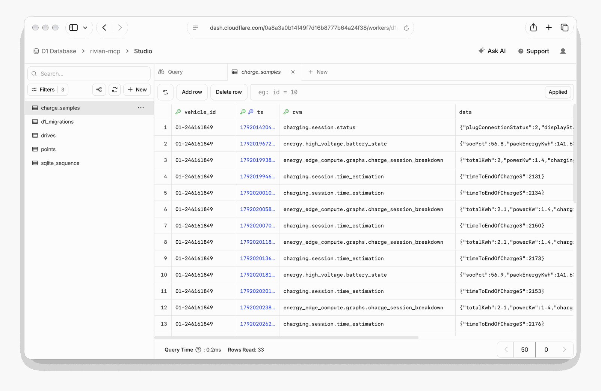

- Your Rivian password goes straight to Rivian and is not stored. The Worker keeps the session Rivian returns, the same way the Rivian app stays signed in.
- The first Rivian account that signs in owns your copy. After that, only its email can sign in. Sign-in attempts are limited to 10 per minute.
- Until you sign in, anyone who finds your address can claim your copy with their own Rivian account. Connect right after you deploy. To pin the owner up front, add a `RIVIAN_EMAIL` secret: **Settings**, then **Variables and Secrets**.
- Anyone who finds your address can try passwords for the owner's email, within that limit.

## Remove it

In the Cloudflare dashboard, open **Workers & Pages**, select **rivian-mcp**, then **Settings**, then **Delete**. Under **Storage & Databases**, delete the D1 database and the KV namespace whose names start with `rivian-mcp`. Remove the connector in Claude or ChatGPT. You can delete your copy on GitHub too.

## Set it up from a terminal instead

If you would rather not use GitHub or the browser, you need [Node.js 24](https://nodejs.org) or newer.

```sh
git clone https://github.com/zentered-studios/rivian-mcp.git
cd rivian-mcp
npm install
npx wrangler login
npm run deploy
```

`npm run deploy` creates the storage on the first run, deploys, and sets up the database. Answer `y` if it asks. To update later, run `git pull`, `npm install` and `npm run deploy` again.
